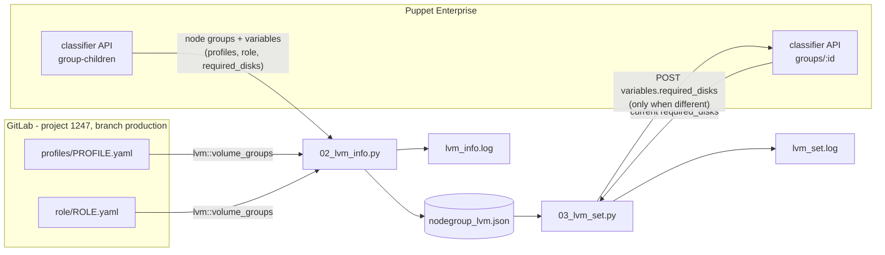
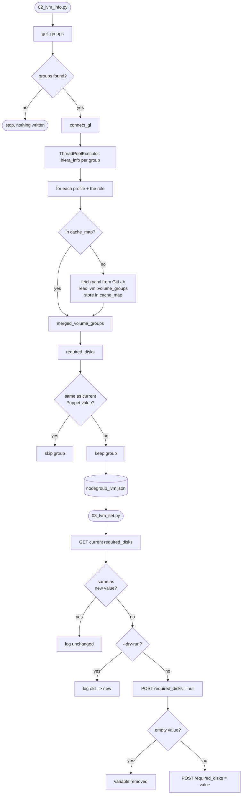

# diskparse

Works out how much disk space each Puppet node group needs, from the LVM settings in its hiera profiles and role, and writes the result back to the node group as the `required_disks` variable.

| Script | What it does |
|---|---|
| `02_lvm_info.py` | Collects `lvm::volume_groups` for every node group, calculates `required_disks`, and writes the groups that need a change to `nodegroup_lvm.json` |
| `03_lvm_set.py` | Reads `nodegroup_lvm.json` and writes `required_disks` into the Puppet node groups |

## Requirements

- Python 3.9+
- Packages:

  ```
  pip install requests pyyaml python-dotenv python-gitlab aiohttp
  ```

- A `.env` file in the directory you run the scripts from (it is in `.gitignore`, never commit it):

  ```
  # Puppet classifier API
  PUPPET_TOKEN=<puppet rbac token>
  GROUP_CHILDREN_URL=https://<puppet-console>:4433/classifier-api/v1/group-children
  ROOT_PARENT=<id of the root node group>
  GROUPS_URL=https://<puppet-console>:4433/classifier-api/v1/groups

  # GitLab with the hiera data
  GL_URL=https://<gitlab-server>
  GL_TOKEN=<gitlab token with read_api / read_repository>
  ```

  | Variable | Used by | Purpose |
  |---|---|---|
  | `PUPPET_TOKEN` | both | Sent as the `X-Authentication` header |
  | `GROUP_CHILDREN_URL`, `ROOT_PARENT` | `02_lvm_info.py` | Fetches the node group tree, including each group's variables |
  | `GROUPS_URL` | `03_lvm_set.py` | Updates a node group (`POST {GROUPS_URL}/{id}`) |
  | `GL_URL`, `GL_TOKEN` | `02_lvm_info.py` | Reads the hiera files from GitLab |

  The GitLab project (`PROJECT_ID = 1247`) and branch (`BRANCH = "production"`) are set at the top of `02_lvm_info.py`.

## Running

```
python3 02_lvm_info.py              # 1. collect + calculate  -> nodegroup_lvm.json, lvm_info.log
python3 03_lvm_set.py --dry-run     # 2. check what would be written -> lvm_set.log
python3 03_lvm_set.py               # 3. write to Puppet -> lvm_set.log
```

1. **`02_lvm_info.py`** writes only the groups whose calculated `required_disks` differs from the value already in Puppet, including a value with the same disks in a different order (see [Disk order](#disk-order)). A run where nothing changed gives an empty list (`[]`). Hiera files that are missing or can't be read are logged in `lvm_info.log`.
2. **`03_lvm_set.py --dry-run`** reads the current `required_disks` of every group in `nodegroup_lvm.json` from Puppet and logs the change it would make (`old => new`), without writing anything. Check `lvm_set.log` before the real run.
3. **`03_lvm_set.py`** writes the values. Failed requests are logged as `ERROR` in `lvm_set.log`, with the HTTP status and the response body.

`03_lvm_set.py` is idempotent: it only writes to groups whose current value in Puppet differs from the value in `nodegroup_lvm.json` (a different disk order counts as a difference), so running it again does nothing. The last line of `lvm_set.log` gives the totals (`changed`, `unchanged`, `failed`, `skipped`). If any group failed, the script exits with code `1`.

Running `02_lvm_info.py` again after a successful update should give `[]`. Both log files are overwritten on every run.

## Architecture



The two scripts are connected only through `nodegroup_lvm.json`. This means you can review or edit the calculated values before anything is written to Puppet.

### 02_lvm_info.py

| Function | Role |
|---|---|
| `get_groups()` | One request to `GROUP_CHILDREN_URL/ROOT_PARENT`. Returns `id`, `name` and `variables` for the top-level groups, plus the children of groups that have children (two levels deep). The `ALL` group is skipped. |
| `connect_gl()` | Connects to GitLab and checks the token (`gl.auth()`). Exits on an invalid token. |
| `hiera_info(groep, project)` | Runs per group in a `ThreadPoolExecutor` (max `min(32, cpu + 4)` threads). Gets the LVM data for each profile and the role, then calls `required_disks()` and compares the result with the current Puppet value. |
| `lvm_info(project, pad, naam, groep)` | Fetches `{pad}/{naam}.yaml` from GitLab and returns `lvm::volume_groups`. The result is stored in `cache_map`, a dict shared by all threads and protected by a lock, so each profile or role is usually fetched only once. A 404 is cached too. Other errors are not cached, so a later group can try again. |
| `merged_volume_groups(tempresult)` | Deep merges the volume groups of all profiles and the role into one definition per VG (see [Merging](#merging)). |
| `required_disks(tempresult)` | Applies the [sizing rules](#sizing-rules) and returns `{"/dev/sdX": ["<GB>"]}`, sorted by device name (see [Disk order](#disk-order)). |
| `size_in_g(lv_name, lv_conf)` | Converts the size of one logical volume to G. |

Output per group in `nodegroup_lvm.json`:

```json
{
  "id": "0ac0c1e4-db14-484e-b0a0-958c364aeb37",
  "name": "FSS_P",
  "profielen": [ { "oracle_client": { "VG01": { ... } } } ],
  "rol": { "tbsalaris_fss_p": { "VG01": { ... } } },
  "required_disks": { "/dev/sdb": ["340"] }
}
```

`profielen` and `rol` are kept so you can check how a value was calculated. `03_lvm_set.py` only uses `id`, `name` and `required_disks`.

### 03_lvm_set.py

Reads `nodegroup_lvm.json` and runs one `asyncio` task per group with `aiohttp`. A semaphore limits this to `MAX_CONCURRENT = 10` groups at the same time. For each group it:

1. Gets the group (`GET {GROUPS_URL}/{id}`) and reads its current `required_disks`. A missing or empty value counts as `{}`.
2. If the current value is the same as the new one, with the disks in the same order, it logs `unchanged` and stops. With `--dry-run` it stops here as well, after logging the change it would make.
3. Posts `{"variables": {"required_disks": null}}`. This removes the current value, so the new value replaces it instead of being merged into it.
4. If the new `required_disks` is not empty, posts `{"variables": {"required_disks": {...}}}`. If it is empty (`{}`), the variable stays removed.

If a step fails (HTTP 4xx/5xx, or Puppet can't be reached), the group is logged as `failed` and the next steps are skipped. The other groups continue.

The comparison uses the value in Puppet at the moment `03_lvm_set.py` runs, not the value `02_lvm_info.py` saw. This means it is also correct when you run it twice, or when someone changed a group between the two scripts.

## Flow



## Sizing rules

For each disk, `required_disks` is the sum of all logical volumes in the volume groups on that disk, plus 5G:

| Situation | Counts as |
|---|---|
| `size` in G or GB (`50G`, `100GB`, `1.0G`) | that number |
| `size` in M or MB (`75000M`, `128MB`) | `/1000`, rounded up, + 5G (`75000M` → 80, `128MB` → 6) |
| `size` in T or TB | ×1000 |
| `"extents": "100%FREE"` | 50G |
| no `size` | 50G |
| unknown size format | 50G, with a warning in `lvm_info.log` |
| `"ensure": "absent"` | not counted |
| volume group `VGsystem`, disk `/dev/sda` and its partitions (`/dev/sda2`, not `/dev/sdaa`) | ignored |
| every disk | + 5G reserved for LVM metadata/header |

The total is rounded up to a whole number and stored as a string in a list, e.g. `{"/dev/sdb": ["96"], "/dev/sdc": ["55"]}`.

### Disk order

The disks in `required_disks` are always sorted by device name, whatever order the volume groups have in the profiles and the role. They are sorted on the length of the name first and then alphabetically, so the order also stays right past 26 disks:

```
/dev/sdb, /dev/sdc, ... /dev/sdz, /dev/sdaa, /dev/sdab
```

A plain alphabetical sort would put `/dev/sdaa` before `/dev/sdb`.

Both scripts include the order when they compare with the current value in Puppet (`zelfde_disks()`). A value in Puppet with the right disks and sizes but in the wrong order, e.g. `{"/dev/sdb": ["25"], "/dev/sdc": ["545"], "/dev/sde": ["125"], "/dev/sdd": ["245"]}`, counts as a change. It ends up in `nodegroup_lvm.json` and `03_lvm_set.py` rewrites it in sorted order. The `null` post removes the old value first, so the new order really replaces it.

This relies on Puppet returning the keys in the order they were stored. A second run of `03_lvm_set.py` should show `changed: 0`. If the same groups show up as changed on every run, Puppet changes the order itself, and the order check has to be removed from `zelfde_disks()`.

### Merging

Before counting, the volume groups of all profiles and the role are merged per VG name:

- `physical_volumes` (a list or a dict) are combined. This means a VG whose logical volumes are in a profile but whose disk is only defined in the role (e.g. `C2IM_NSP_NFMP_*`) is still linked to that disk.
- A logical volume defined in more than one place is counted once. Later profiles override earlier ones, and the role overrides all profiles. For example, `%{lookup('lv_ora_client')}` is 5G in `oracle_client_19c` and 10G in the `tbsalaris_9_*` roles, so it counts as 10G.

### Known limitations

- Hiera lookups such as `%{lookup('lv_ora_client')}` are not resolved. If a lookup names the same LV as another entry (e.g. `LV-app-oracle`), that LV is counted twice.
- If a VG has more than one disk, its whole total is assigned to the first disk and a warning is logged.
- A VG that has logical volumes but no `physical_volumes` anywhere is skipped, with a warning.
- A disk whose logical volumes are all `absent` still gets the 5G reserve.
- `get_groups()` goes only two levels deep in the node group tree.
- If two threads ask for the same hiera file at the same moment, it can be downloaded twice. The result is the same.
